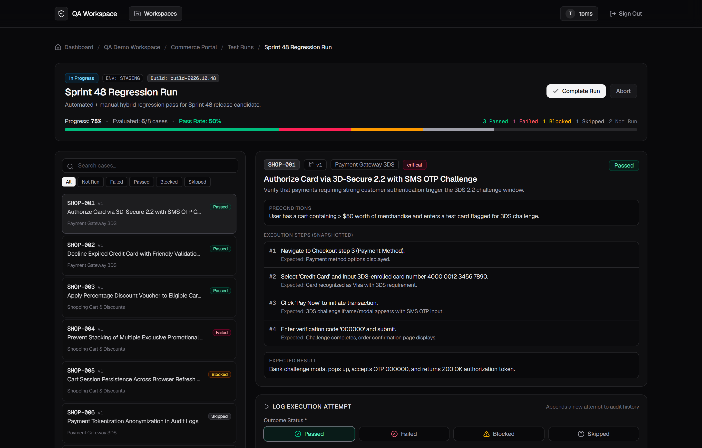
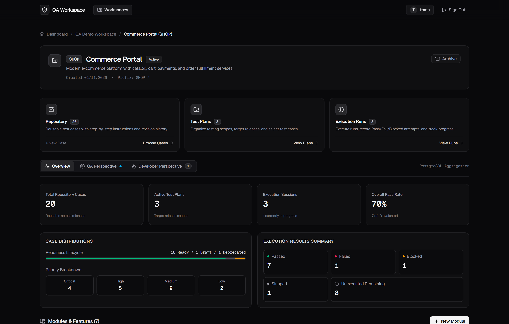
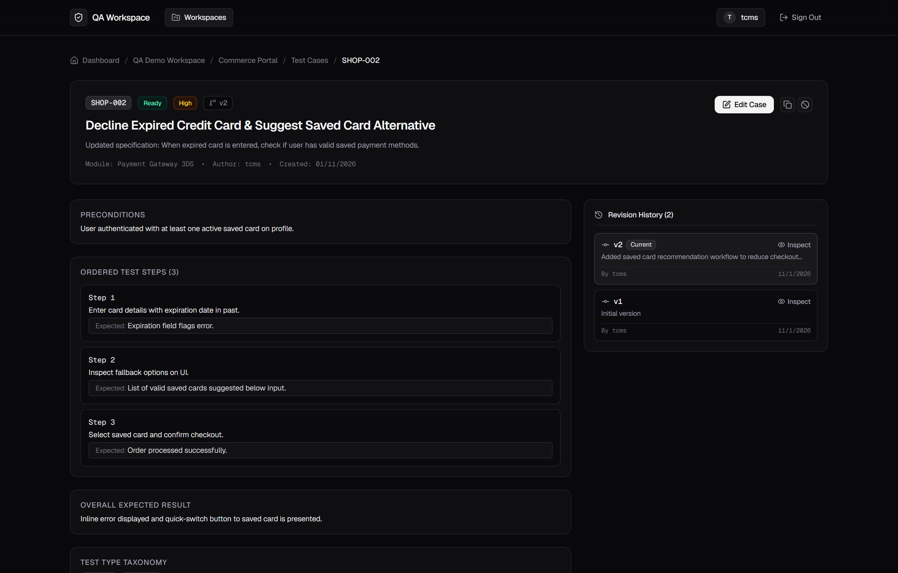
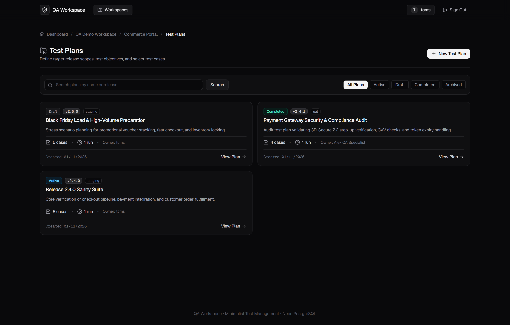
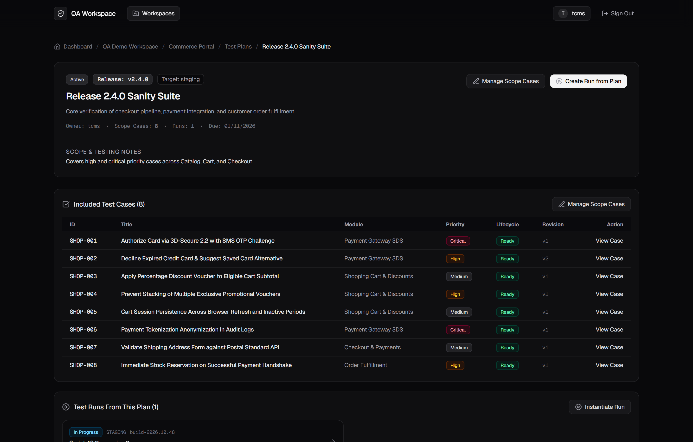
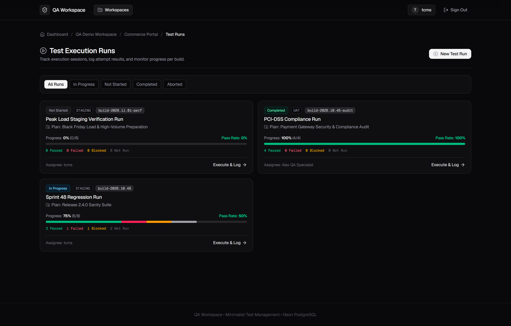
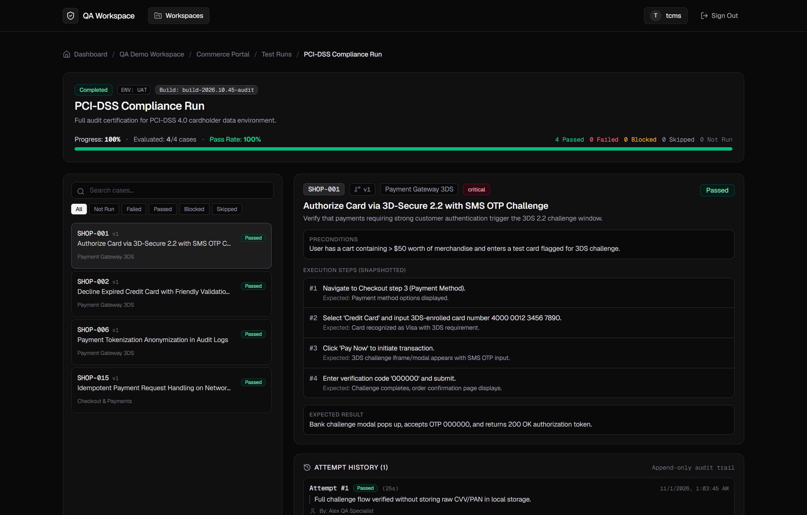
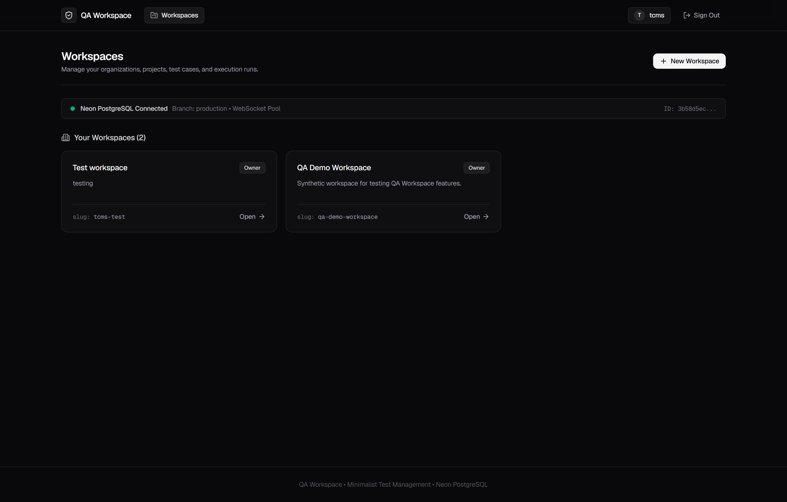
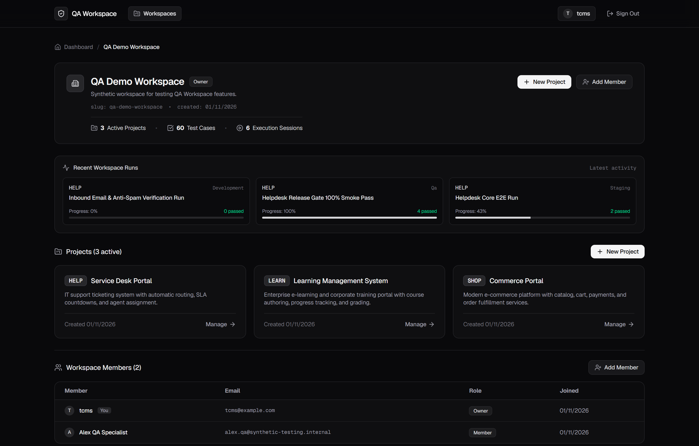
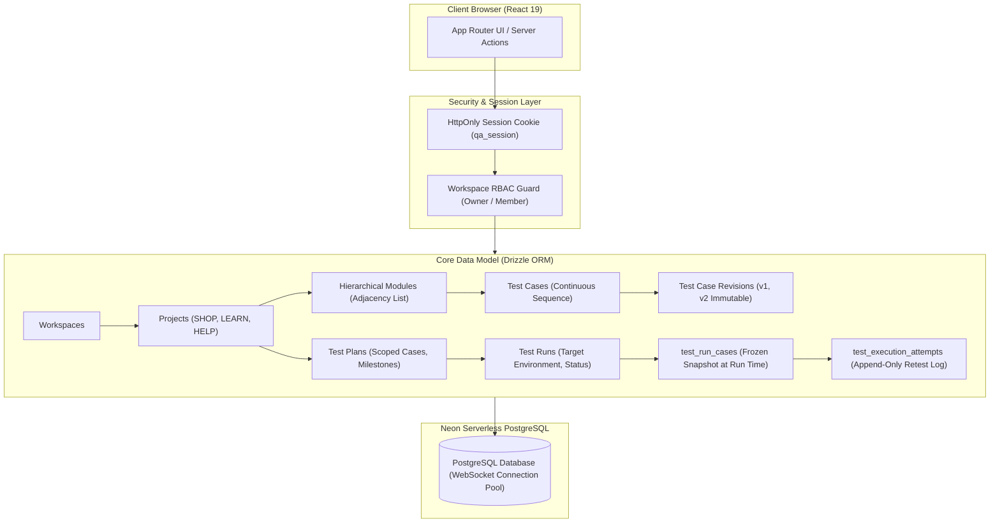

# QA Workspace (TCMS)

**Enterprise test case management with immutable execution snapshots, append-only retest audit trails, and multi-tenant workspace isolation.**

[Screenshots](#in-action) · [Architecture](#architecture) · [The Problem](#the-problem) · [Design Trade-offs](#key-design-trade-offs) · [Verification Results](#results) · [Demo Accounts](#try-it) · [Tech Stack](#stack)

---


*Interactive execution runner showing append-only retest history (#1 Failed $\rightarrow$ #2 Passed for SHOP-001), frozen revision snapshots, and real-time execution telemetry.*

---

## Contents

- [Overview](#overview)
- [In action](#in-action)
- [The problem](#the-problem)
- [How it works](#how-it-works)
- [Architecture](#architecture)
- [Key design trade-offs](#key-design-trade-offs)
- [Results](#results)
- [Business value](#business-value)
- [Try it](#try-it)
- [Stack](#stack)

---

## Overview

**QA Workspace** is an enterprise-grade Test Case Management System (TCMS) engineered with **Next.js 16 App Router**, **React 19**, and **Neon Serverless PostgreSQL**. It provides end-to-end quality assurance operations: hierarchical test repository authoring, substantive revision history tracking, milestone-driven test planning, immutable execution run snapshots, and an append-only retest engine.

Most existing test management solutions suffer from **test drift**: when a test case is edited in the repository, historical test runs retroactively reflect the new specification, invalidating past compliance audits. Similarly, when a failed test is retested and passes, traditional tools overwrite the original failure, destroying diagnostics and concealing test flakiness.

QA Workspace solves both problems at the data layer:
1. **Snapshot Immutability**: Launching a test run freezes the exact revision specification (title, preconditions, steps, expected results) into `test_run_cases`. Repository updates never corrupt historical execution records.
2. **Append-Only Retest Trails**: Every test execution attempt is saved as a discrete chronological record in `test_execution_attempts`. A passing retest preserves prior failures, durations, actual results, and executor identities.
3. **Multi-Tenant Workspace & Project Scoping**: Complete relational isolation across workspaces and projects, enforced at the SQL query level with role-based access control (`owner`, `member`).

The platform includes a pre-seeded enterprise workspace—**QA Demo Workspace (`qa-demo-workspace`)**—featuring three distinct projects:
- **Commerce Portal (`SHOP`)**: E-commerce cart, 3D-Secure 2.2 payment gateway, and checkout pipelines (20 cases, 7 modules, 3 plans, 3 runs).
- **Learning Management System (`LEARN`)**: Course authoring, SCORM multimedia packages, and quiz engines (20 cases, 6 modules, 3 plans, 3 runs).
- **Service Desk Portal (`HELP`)**: SLA countdown engines, escalation dispatchers, and omnichannel routing (20 cases, 5 modules, 3 plans, 3 runs).

---

## In action

| Project Repository & Hierarchical Module Tree | Substantive Revision History (v1 $\rightarrow$ v2) |
| :--- | :--- |
| <br/>*Hierarchical module tree (`Checkout & Payments` $\rightarrow$ `Payment Gateway 3DS`) with project-scoped sequential IDs (`SHOP-001` .. `SHOP-020`), priority badges, and taxonomy tags.* | <br/>*Substantive revision tracking for `SHOP-002`: Displays initial v1 vs updated v2 specifications with change summaries while keeping historic run snapshots intact.* |

| Test Plans Matrix & Scope Management | Scoped Test Plan Details |
| :--- | :--- |
| <br/>*Test Plans dashboard: Managing smoke, regression, and audit suites with target releases (`v2.4.0`), environments (`staging`, `uat`), and statuses (`active`, `completed`, `draft`).* | <br/>*Granular test plan detail showing case inclusions across modules, timeline dates (`plannedStartDate`, `dueDate`), and owner assignments.* |

| Multi-Environment Test Runs Orchestration | Audit-Certified 100% Passed Run |
| :--- | :--- |
| <br/>*Test Runs view across `staging`, `uat`, and `development`: Status badges (`in_progress`, `completed`, `not_started`), pass rates, and executor assignments.* | <br/>*Completed `PCI-DSS Compliance Run`: 100% Pass rate (4/4 cases) with zero defects, signed off for regulatory compliance audit.* |

| Executive Quality Dashboard | Multi-Tenant Workspace & Team Management |
| :--- | :--- |
| <br/>*Executive overview: Real-time PostgreSQL aggregations, active test runs, recent activity feeds, and cross-project quality health.* | <br/>*Workspace hub: Project cards (`SHOP`, `LEARN`, `HELP`), team member management, and role badges (`owner`, `member`).* |

---

## The problem

Traditional test case management platforms frequently break down in production environments due to three critical structural flaws:

### 1. Test Drift & Retrospective Corruption
When engineers update a test case in the repository—such as updating an API contract or UI selector—most test management systems update the entity in-place. If that test case was executed in a release test run six months earlier, the historical run now displays the *new* instructions and expected results. During ISO 27001, SOC 2, or PCI-DSS audits, QA leads cannot prove what exact test steps were executed at release time.

### 2. Destructive Retest Overwriting
When a test case fails due to an intermittent race condition or transient infrastructure failure and is subsequently retested and marked `Passed`, conventional tools overwrite the original execution status. The previous failure notes, execution duration, and timestamp are erased. Engineering teams lose the historical context necessary to detect flaky tests, intermittent memory leaks, or recurring regressions.

### 3. Flat Hierarchy & Cross-Project Bleed
Flat tagging systems fail as test suites scale past a few dozen cases. Complex software requires nested component hierarchies (e.g., `Billing` $\rightarrow$ `Invoicing` $\rightarrow$ `Tax Calculation`). Furthermore, multi-project organizations require strict boundaries: a test run in an e-commerce platform must never accidentally include cases from an internal helpdesk project.

---

## How it works

QA Workspace enforces quality engineering invariants through a deterministic 7-step pipeline:

```
[1. User & RBAC Auth] 
       │
       ▼
[2. Module Hierarchy & Project Repository] ──► [Continuous Sequential IDs: SHOP-001..020]
       │
       ▼
[3. Substantive Change Detection] ──────────► [Immutable Revision Records: v1, v2, ...]
       │
       ▼
[4. Test Plan Milestone Scoping] ──────────► [Scoped Cases by Module & Priority]
       │
       ▼
[5. Test Run Launch] ──────────────────────► [Freeze Revision Snapshot in test_run_cases]
       │
       ▼
[6. Interactive Execution Runner] ─────────► [Record Execution Attempt]
       │
       ▼
[7. Append-Only Retest Engine] ────────────► [Preserve Attempt #1 (Failed) + #2 (Passed)]
```

1. **Authentication & Role Authorization**: Validated server-side via HttpOnly session cookies linked to relational PostgreSQL sessions. Role claims are resolved against `workspace_members` on every request.
2. **Project Repositories & Sequential Identifiers**: Test cases receive atomic, continuous sequence numbers scoped to each project key (e.g., `SHOP-001`, `SHOP-002`). Modules are organized via an adjacency-list self-referencing hierarchy.
3. **Substantive Change Detection**: When a user modifies a test case, the system distinguishes between cosmetic metadata changes (tags, priority) and substantive test specification changes (title, preconditions, ordered steps, expected results). Substantive changes automatically increment the case revision and generate an immutable record in `test_case_revisions`.
4. **Milestone-Driven Test Planning**: Test plans aggregate test cases across multiple modules and priorities, setting clear target releases (`v2.4.0`), target environments (`staging`), planned start dates, and due dates.
5. **Snapshot Immutability at Run Creation**: When a test run is initiated, the system takes a frozen snapshot of the active revision for each included case and persists it into `test_run_cases`. Even if the repository test case advances to revision 2, 3, or 4 later, the test run continues to display the exact snapshot captured at execution time.
6. **Split-Pane Execution Runner**: Testers execute runs in an interactive split-pane interface (`/test-runs/[runId]`). The left pane provides instant status navigation and overall run telemetry; the right pane displays the frozen snapshot steps, preconditions, expected results, and execution actions.
7. **Append-Only Retest Engine**: Setting a status (Passed, Failed, Blocked, Skipped) writes a permanent record into `test_execution_attempts` with duration, actual result, executor ID, and timestamp. A subsequent retest appends Attempt #2 without mutating Attempt #1. The run case's `current_status` reflects the latest attempt.

---

## Architecture



### Trust Boundaries

| Trust Boundary | What Crosses It | How It Is Enforced |
| :--- | :--- | :--- |
| **Client Entry** | Browser requests & Next.js Server Actions | HttpOnly session cookie validated against `sessions` table. CSRF protection via Next.js action tokens. |
| **Workspace Boundary** | Workspace navigation & data retrieval | Every query joins `workspace_members` with user session ID. Users can never view or mutate entities outside their workspace. |
| **Project Boundary** | Project test cases, plans, and runs | Relational foreign keys restrict queries to `project_id`. Test runs strictly reject cases originating from other projects. |
| **Execution Immutability** | Repository edits vs Historical runs | `test_run_cases` stores frozen string and JSON snapshots (`snapshot_title`, `snapshot_steps`, etc.). Foreign key `ON DELETE RESTRICT` prevents accidental deletion of historical runs. |
| **Retest Audit Trail** | Retesting failed cases | New attempts write new rows to `test_execution_attempts`. In-place updates to prior attempt records are forbidden. |
| **Database Pool** | Server Actions to Neon PostgreSQL | `@neondatabase/serverless` connected over WebSockets (`ws` + `Pool`) supporting interactive multi-statement transactions. |

---

## Key design trade-offs

| Decision | Alternative We Rejected | Reason |
| :--- | :--- | :--- |
| **Snapshot Freezing in `test_run_cases`** | Foreign key pointer to live `test_cases` row | Live pointers cause "test drift": updating a test case corrupts historical audit trails for runs executed months ago. Freezing the snapshot guarantees 100% audit integrity. |
| **Append-Only Retest Attempts Table** | Overwriting `status` column in `test_run_cases` | Overwriting erases the failure evidence. Storing attempts in `test_execution_attempts` preserves the full history (e.g. Attempt 1 Failed $\rightarrow$ Attempt 2 Passed) for defect and flakiness analysis. |
| **Project-Scoped Continuous Sequence Numbers (`SHOP-001`)** | Global auto-increment integer or raw UUIDs | Engineers need readable, human-friendly identifiers. Sequential counters scoped to each project key eliminate cross-project numbering conflicts. |
| **Substantive Change Detection** | Creating a revision on every metadata edit | Tag or priority tweaks do not alter the test specification. Restricting revisions to title, steps, preconditions, and expected results keeps the revision history meaningful. |
| **Next.js Server Actions with Drizzle ORM** | Separate microservice REST/GraphQL backend | Collocates type-safe server logic directly with React 19 Server Components, eliminating API boilerplate while maintaining strict database transactions. |
| **WebSocket Connection Pooling (`@neondatabase/serverless` + `ws`)** | Stateless HTTP fetch queries | Interactive multi-statement transactions (e.g., creating a run while generating 20 frozen snapshots and initial attempts) require persistent WebSocket connection pooling. |

---

## Results

Verified via the automated test suite ([`src/scripts/verify-step-06.ts`](file:///D:/shigoto/ltls/tcms/src/scripts/verify-step-06.ts)):

```
=== QA Workspace: Step 06 Seeding Verification ===

[1/6] Verifying Workspace & Memberships...
  ✓ Workspace confirmed: 'QA Demo Workspace' (ID: 6a30b205-2b74-4965-ab84-add5fc2b784c)
  ✓ Members confirmed: 2 members with roles 'owner' and 'member'

[2/6] Verifying Projects & Module Hierarchy...
  ✓ 3 Projects confirmed: HELP, LEARN, SHOP
  ✓ Module hierarchy verified: 'Checkout & Payments' -> 'Payment Gateway 3DS'

[3/6] Verifying Test Cases & Ordered Steps...
  ✓ 60 Test Cases confirmed (20 per project)
  ✓ Sequence numbers strictly continuous 1..20 in project SHOP

[4/6] Verifying Snapshot Immutability Invariant...
  ✓ Repository case SHOP-002 has 2 revisions. Active title: 'Decline Expired Credit Card & Suggest Saved Card Alternative'
  ✓ Invariant Verified: Test Run preserves immutable v1 snapshot ('Decline Expired Credit Card with Friendly Validation Message') while repo case has advanced to v2

[5/6] Verifying Append-Only Retest Attempts (Failed -> Passed)...
  ✓ Invariant Verified: Retest workflow preserves Attempt #1 ('failed') and Attempt #2 ('passed') without overwrite

[6/6] Verifying Plans, Runs, and Execution Scenarios...
  ✓ Project SHOP: 3 Plans and 3 Runs verified.
  ✓ Project LEARN: 3 Plans and 3 Runs verified.
  ✓ Project HELP: 3 Plans and 3 Runs verified.
  ✓ Plan statuses varied: draft, active, completed, archived
  ✓ Run statuses varied: not_started, in_progress, completed
  ✓ Environments varied across runs: development, qa, staging, uat
  ✓ All 9 Test Plans contain valid plannedStartDate and dueDate.

  Verifying Project & Plan Scoping Integrity...
  ✓ All 6 Mandatory Execution Scenarios confirmed present and correct.
  ✓ Project & Plan scoping integrity confirmed: zero cross-project or out-of-plan cases.

🎉 ALL STEP 06 SEEDING ACCEPTANCE CRITERIA VERIFIED!
```

### Complete Test Execution Summary Table

| Project | Test Plan | Plan Cases | Test Run | Environment | Run Status | Passed | Failed | Blocked | Skipped | Not Run |
| :--- | :--- | :---: | :--- | :--- | :--- | :---: | :---: | :---: | :---: | :---: |
| **Commerce Portal (SHOP)** | Black Friday Load & High-Volume Preparation | 6 | Peak Load Staging Verification Run | `staging` | `not_started` | 0 | 0 | 0 | 0 | **6** |
| **Commerce Portal (SHOP)** | Release 2.4.0 Sanity Suite | 8 | Sprint 48 Regression Run | `staging` | `in_progress` | **3** | **1** | **1** | **1** | **2** |
| **Commerce Portal (SHOP)** | Payment Gateway Security & Compliance Audit | 4 | PCI-DSS Compliance Run | `uat` | `completed` | **4** | 0 | 0 | 0 | 0 |
| **Learning Management System (LEARN)** | Q4 Platform Release Acceptance Plan | 8 | LMS Core Smoke & Acceptance Run | `staging` | `completed` | **8** | 0 | 0 | 0 | 0 |
| **Learning Management System (LEARN)** | Q4 Platform Release Acceptance Plan | 8 | Mid-Sprint Regression & Accessibility Pass | `qa` | `in_progress` | **1** | **1** | **1** | 0 | **2** |
| **Learning Management System (LEARN)** | SCORM Interactive Multimedia Certification | 4 | Cross-Browser Media & A11y Run | `development` | `not_started` | 0 | 0 | 0 | 0 | **4** |
| **Service Desk Portal (HELP)** | SLA Engine & Escalation Critical Path Plan | 7 | Helpdesk Core E2E Run | `staging` | `in_progress` | **2** | **1** | **1** | **1** | **2** |
| **Service Desk Portal (HELP)** | SLA Engine & Escalation Critical Path Plan | 7 | Helpdesk Release Gate 100% Smoke Pass | `qa` | `completed` | **4** | 0 | 0 | 0 | 0 |
| **Service Desk Portal (HELP)** | Omnichannel Ticket Ingestion Verification Plan | 4 | Inbound Email & Anti-Spam Verification Run | `development` | `not_started` | 0 | 0 | 0 | 0 | **4** |

### Mandatory Scenarios Coverage

1. **100% Passed Run**: `PCI-DSS Compliance Run` (SHOP, 4/4 passed), `LMS Core Smoke` (LEARN, 8/8 passed), `Helpdesk Release Gate` (HELP, 4/4 passed).
2. **Combination of Passed, Failed, Blocked**: `Sprint 48 Regression Run` (SHOP), `Mid-Sprint Regression Pass` (LEARN), `Helpdesk Core E2E Run` (HELP).
3. **In-Progress with Several Not Run**: `Sprint 48 Regression Run` (2 Not Run), `Mid-Sprint Regression Pass` (2 Not Run), `Helpdesk Core E2E Run` (2 Not Run).
4. **Retest (Failed $\rightarrow$ Passed)**: `SHOP-001` (Attempt 1: Failed $\rightarrow$ Attempt 2: Passed), `LEARN-004` (Attempt 1: Failed $\rightarrow$ Attempt 2: Passed). *Also covers multi-attempt remaining failed*: `HELP-002` (Attempt 1: Failed $\rightarrow$ Attempt 2: Failed).
5. **Skipped with Concrete Reason**: `SHOP-006` (*"Feature flag for multi-currency settlement was toggled off on staging"*), `HELP-005` (*"Automated CSV reporting cron job is suspended for maintenance"*).
6. **Not Started with Zero Attempts**: `Peak Load Staging Verification Run` (6 Not Run, 0 attempts), `Cross-Browser Media & A11y Run` (4 Not Run, 0 attempts), `Inbound Email & Anti-Spam Verification Run` (4 Not Run, 0 attempts).

---

## Business value

- **Audit & Regulatory Compliance**: Eliminates retrospective test fraud. Audit trails for releases are guaranteed to reflect the exact test definitions evaluated at build time.
- **Root-Cause Defect Resolution**: Preserving full failure logs across multiple retest attempts enables developers to understand whether an intermittent bug was truly fixed or merely hidden by non-deterministic test ordering.
- **Fast QA Execution Velocity**: The distraction-free split-pane runner enables QA engineers to execute test suites and record multi-step evidence in seconds without tab switching.
- **Cross-Functional Visibility**: Engineering leadership obtains immediate visibility into release gate blockers, environment health, and module coverage through real-time database aggregations.

---

## Try it

### Demo Accounts

| Account Email | Password | Workspace Role | Purpose / Suggested Flow |
| :--- | :--- | :--- | :--- |
| `tcms@example.com` | `tcms123` | **Owner / Admin** | Full administrative control, member invitations, project management, and run authoring. |
| `alex.qa@synthetic-testing.internal` | `Password123!` | **Member / QA Specialist** | Executing test runs, logging execution attempts, authoring test cases, and updating test plans. |

### Suggested Scenarios to Try

1. **Explore the Retest Trail in the Split-Pane Runner**:
   - Log in as `tcms@example.com`.
   - Navigate to **QA Demo Workspace** $\rightarrow$ **Commerce Portal (`SHOP`)** $\rightarrow$ **Test Runs**.
   - Open **Sprint 48 Regression Run**.
   - Click on `SHOP-001` (`Authorize Card via 3D-Secure 2.2`). Notice the chronological attempt history: **Attempt #1 Failed** (SMS OTP timeout) and **Attempt #2 Passed** (bypass code). Both attempts are preserved with individual timestamps and notes.
2. **Verify Snapshot Immutability**:
   - In the same test run, select `SHOP-002`. Notice that the title and steps displayed are from **Revision 1** (*"Decline Expired Credit Card with Friendly Validation Message"*).
   - Now navigate to the project repository under **Test Cases** and view `SHOP-002`. The active case is at **Revision 2** (*"Decline Expired Credit Card & Suggest Saved Card Alternative"*). The test run preserves the immutable snapshot frozen at run creation time.
3. **Inspect Completed & In-Progress Runs**:
   - View **PCI-DSS Compliance Run** to inspect a 100% Passed compliance gate.
   - View **Mid-Sprint Regression & Accessibility Pass** in `LEARN` to inspect blocked dependencies and ongoing execution telemetry.

---

## Stack

| Layer | Technology |
| :--- | :--- |
| **Web Framework** | Next.js 16.4.3 (App Router, Server Actions, React 19 Server Components) |
| **Frontend & UI** | React 19.3.0, Tailwind CSS v4, Lucide React icons, clsx, tailwind-merge |
| **Database** | Neon Serverless PostgreSQL (`production` branch) |
| **Database Client & ORM** | Drizzle ORM v0.45.4 with `@neondatabase/serverless` |
| **Connection Protocol** | WebSocket connection pooling (`ws` v8.22.1 + `Pool`) supporting interactive multi-statement transactions |
| **Validation & Schema** | Zod v4.6.7 schema validation for all Server Actions |
| **Authentication & Security** | Relational sessions in PostgreSQL, bcryptjs password hashing, HttpOnly secure cookies, server-side RBAC |
| **CSV Engine** | Custom RFC 4180 parser with two-phase dry-run validation |
| **Testing & Verification** | TypeScript verification suite (`src/scripts/verify-step-06.ts`), Puppeteer Core screenshot automation |
